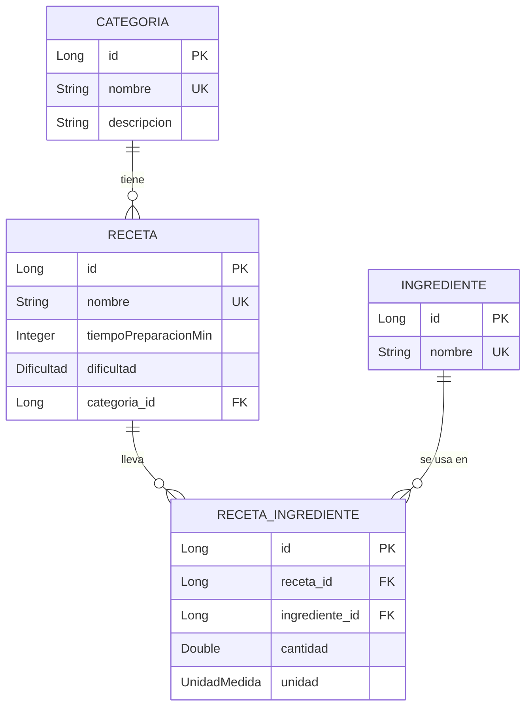

[README.md](https://github.com/user-attachments/files/33868256/README.md)
# 🍲 Gestión de Recetas y Categorías · API REST

API REST desarrollada con **Spring Boot** para gestionar **recetas**, **categorías** e **ingredientes**. Permite organizar las recetas por categorías y asociar a cada receta los ingredientes que lleva, con su cantidad y su unidad de medida.

Proyecto individual (Tipo B) de las asignaturas **Acceso a Datos** y **Programación de Servicios y Procesos**, curso 2026-27.

---

## 📑 Índice

1. [Tecnologías](#-tecnologías)
2. [Cómo ejecutar el proyecto](#-cómo-ejecutar-el-proyecto)
3. [Modelo de datos](#-modelo-de-datos)
4. [Funcionalidades](#-funcionalidades)
5. [Endpoints](#-endpoints)
6. [Ejemplos de uso](#-ejemplos-de-uso)
7. [Validaciones](#-validaciones)
8. [Gestión de errores](#-gestión-de-errores)
9. [Documentación OpenAPI y Swagger](#-documentación-openapi-y-swagger)
10. [Cómo probar la API](#-cómo-probar-la-api)
11. [Metodología de trabajo](#-metodología-de-trabajo)
12. [Estructura del proyecto](#-estructura-del-proyecto)
13. [Autor](#-autor)

---

## 🛠️ Tecnologías

| Tecnología | Uso |
|---|---|
| Java 21 o superior | Lenguaje |
| Spring Boot | Framework principal |
| Spring Web | API REST |
| Spring Data JPA | Acceso a datos |
| Bean Validation (Jakarta) | Validación de las peticiones |
| Lombok | Reducción de código repetitivo |
| springdoc-openapi | Documentación OpenAPI 3.0 y Swagger UI |
| Maven | Gestión de dependencias |
| Postman y fichero `.http` | Pruebas de la API |

---

## 🚀 Cómo ejecutar el proyecto

### Requisitos

- JDK 21 o superior
- Git

### Pasos

```bash
git clone https://github.com/ach2raf/gestion-de-recetas-y-categorias.git
cd gestion-de-recetas-y-categorias
./mvnw spring-boot:run
```

En Windows:

```bash
mvnw.cmd spring-boot:run
```

La aplicación arranca en `http://localhost:8080`.

| Recurso | URL |
|---|---|
| API | `http://localhost:8080/api/v1` |
| Swagger UI | `http://localhost:8080/swagger-ui/index.html` |
| Definición OpenAPI (JSON) | `http://localhost:8080/v3/api-docs` |
| Consola H2 | `http://localhost:8080/h2-console` (JDBC URL: `jdbc:h2:mem:recetasdb`, usuario `sa`, sin contraseña) |

> La base de datos es en memoria: los datos se pierden al parar la aplicación.

---

## 🗂️ Modelo de datos

Tres entidades y una relación de **muchos a muchos** entre receta e ingrediente, que se resuelve con una entidad intermedia (`RecetaIngrediente`) que guarda además la **cantidad** y la **unidad de medida**.



- **Categoria**: `id`, `nombre` (único), `descripcion`. Una categoría tiene muchas recetas.
- **Receta**: `id`, `nombre` (único), `tiempoPreparacionMin`, `dificultad` (`FACIL`, `MEDIA`, `DIFICIL`) y su categoría.
- **Ingrediente**: `id`, `nombre` (único).
- **RecetaIngrediente**: une una receta con un ingrediente e indica cuánto lleva. No puede repetirse el mismo ingrediente en una receta.
- **UnidadMedida**: `GRAMOS`, `KILOGRAMOS`, `MILILITROS`, `LITROS`, `CUCHARADA_SOPERA`, `CUCHARADITA`, `UNIDAD`, `PIZCA`.

---

## ✨ Funcionalidades

### Categorías (CRUD completo)
- Crear, listar, consultar por id, actualizar y borrar categorías.
- El nombre de la categoría es único.
- No se puede borrar una categoría que todavía tiene recetas.

### Recetas (CRUD completo)
- Crear, listar, consultar por id, actualizar y borrar recetas.
- Al crear una receta es **obligatorio indicar el id de una categoría existente**.
- El nombre de la receta es único y el tiempo de preparación debe ser mayor que 0.
- La consulta de una receta devuelve **la lista de sus ingredientes**, con cantidad y unidad (DTOs anidados).

### Ingredientes (crear y listar)
- Crear un ingrediente y listar todos. El nombre es único.

### Ingredientes de una receta (relación M:M)
- Añadir un ingrediente a una receta indicando **cantidad y unidad de medida** (por ejemplo, 200 gramos o 3 cucharadas soperas).
- Un ingrediente no se puede añadir dos veces a la misma receta.

### Calidad
- Validación de las peticiones, incluida una **validación personalizada** (`@NombreRecetaUnico`).
- Errores devueltos con el formato estándar **`ProblemDetail`** (RFC 7807).
- Documentación **OpenAPI 3.0 + Swagger UI**.
- Colección de **Postman** y fichero **`test.http`** con todas las peticiones y los casos de error.

---

## 🔌 Endpoints

Ruta base: `/api/v1`

### Categorías · `/api/v1/categorias`

| Método | Ruta | Descripción | Respuestas |
|---|---|---|---|
| `POST` | `/api/v1/categorias` | Crear una categoría | 201, 400, 409 |
| `GET` | `/api/v1/categorias` | Listar todas las categorías | 200, 404 |
| `GET` | `/api/v1/categorias/{id}` | Obtener una categoría | 200, 400, 404 |
| `PUT` | `/api/v1/categorias/{id}` | Actualizar una categoría | 200, 400, 404, 409 |
| `DELETE` | `/api/v1/categorias/{id}` | Borrar una categoría | 204, 400, 404, 409 |

### Ingredientes · `/api/v1/ingredientes`

| Método | Ruta | Descripción | Respuestas |
|---|---|---|---|
| `POST` | `/api/v1/ingredientes` | Crear un ingrediente | 201, 400, 409 |
| `GET` | `/api/v1/ingredientes` | Listar todos los ingredientes | 200, 404 |

### Recetas · `/api/v1/recetas`

| Método | Ruta | Descripción | Respuestas |
|---|---|---|---|
| `POST` | `/api/v1/recetas` | Crear una receta (requiere `categoriaId`) | 201, 400, 404 |
| `GET` | `/api/v1/recetas` | Listar todas las recetas | 200, 404 |
| `GET` | `/api/v1/recetas/{id}` | Obtener una receta con sus ingredientes | 200, 400, 404 |
| `PUT` | `/api/v1/recetas/{id}` | Actualizar una receta | 200, 400, 404, 409 |
| `DELETE` | `/api/v1/recetas/{id}` | Borrar una receta | 204, 400, 404 |
| `POST` | `/api/v1/recetas/{recetaId}/ingredientes` | Añadir un ingrediente a una receta | 201, 400, 404, 409 |

---

## 📨 Ejemplos de uso

### Crear una categoría

```http
POST /api/v1/categorias
Content-Type: application/json

{
  "nombre": "Postres",
  "descripcion": "Dulces y postres"
}
```

Respuesta `201 Created`:

```json
{
  "id": 1,
  "nombre": "Postres",
  "descripcion": "Dulces y postres"
}
```

### Crear una receta

```http
POST /api/v1/recetas
Content-Type: application/json

{
  "nombre": "Tarta de manzana",
  "tiempoPreparacionMin": 60,
  "dificultad": "MEDIA",
  "categoriaId": 1
}
```

### Añadir un ingrediente a una receta

```http
POST /api/v1/recetas/1/ingredientes
Content-Type: application/json

{
  "ingredienteId": 1,
  "cantidad": 200,
  "unidad": "GRAMOS"
}
```

Respuesta `201 Created` (la receta con sus ingredientes):

```json
{
  "id": 1,
  "nombre": "Tarta de manzana",
  "tiempoPreparacionMin": 60,
  "dificultad": "MEDIA",
  "categoriaId": 1,
  "categoriaNombre": "Postres",
  "categoriaDescripcion": "Dulces y postres",
  "ingredientes": [
    {
      "id": 1,
      "nombre": "Harina",
      "cantidad": 200.0,
      "unidad": "GRAMOS"
    }
  ]
}
```

---

## ✅ Validaciones

Las peticiones se validan con **Bean Validation**. Si algo no es válido, la API responde `400 Bad Request` indicando qué campos fallan.

| Campo | Reglas |
|---|---|
| Categoría · `nombre` | Obligatorio, máximo 100 caracteres |
| Categoría · `descripcion` | Máximo 255 caracteres |
| Ingrediente · `nombre` | Obligatorio, máximo 100 caracteres |
| Receta · `nombre` | Obligatorio, máximo 150 caracteres, **único al crear** |
| Receta · `tiempoPreparacionMin` | Obligatorio y mayor que 0 |
| Receta · `dificultad` | Obligatoria: `FACIL`, `MEDIA` o `DIFICIL` |
| Receta · `categoriaId` | Obligatorio y de una categoría existente |
| Añadir ingrediente · `ingredienteId` | Obligatorio |
| Añadir ingrediente · `cantidad` | Obligatoria y mayor que 0 |
| Añadir ingrediente · `unidad` | Obligatoria |
| Ids de la ruta | Deben ser mayores o iguales a 1 |

### Validación personalizada: `@NombreRecetaUnico`

Anotación propia, con su `ConstraintValidator`, que consulta la base de datos para impedir que se cree una receta con un nombre que ya existe (sin distinguir mayúsculas de minúsculas). Se aplica solo al **crear**, para que al editar una receta se pueda conservar su nombre.

---

## 🚨 Gestión de errores

Todos los errores se devuelven con el formato estándar **`ProblemDetail`** (RFC 7807), gestionados en un `@RestControllerAdvice`.

| Situación | Excepción | Código |
|---|---|---|
| La categoría, la receta o el ingrediente no existe | `CategoriaNotFoundException`, `RecetaNotFoundException`, `IngredienteNotFoundException` | `404 Not Found` |
| El ingrediente ya está en la receta | `IngredienteAlreadyAddedException` | `409 Conflict` |
| Tiempo de preparación menor o igual a 0 | `TiempoInvalidoException` | `400 Bad Request` |
| Id de la ruta no válido | `ConstraintViolationException` | `400 Bad Request` |

Ejemplo de error de validación (`400`):

```json
{
  "type": "about:blank",
  "title": "Datos de entrada no válidos",
  "status": 400,
  "detail": "La petición contiene errores de validación",
  "instance": "/api/v1/recetas",
  "errores": {
    "nombre": "El nombre es obligatorio"
  }
}
```

Ejemplo de recurso no encontrado (`404`):

```json
{
  "type": "about:blank",
  "title": "Recurso no encontrado",
  "status": 404,
  "detail": "Receta not found with id:999",
  "instance": "/api/v1/recetas/999"
}
```

---

## 📚 Documentación OpenAPI y Swagger

La API está documentada con **OpenAPI 3.0** mediante springdoc. Cada endpoint, incluidos los de la relación muchos a muchos, describe su operación y los **códigos de respuesta y de error**.

- Swagger UI (interfaz interactiva): `http://localhost:8080/swagger-ui/index.html`
- Definición en JSON: `http://localhost:8080/v3/api-docs`

---

## 🧪 Cómo probar la API

Con la aplicación arrancada, hay tres formas de probarla.

### 1. Swagger UI
Abre `http://localhost:8080/swagger-ui/index.html` y lanza las peticiones desde el navegador.

### 2. Colección de Postman
1. En Postman, pulsa **Import** y selecciona `postman/Recetas-API.postman_collection.json`.
2. La colección usa la variable `baseUrl` (`http://localhost:8080`).
3. Lanza **Run collection**: las peticiones están ordenadas y cada una comprueba el código HTTP esperado.

### 3. Fichero `test.http`
El fichero `test.http` de la raíz contiene las mismas peticiones y se ejecuta desde IntelliJ IDEA o desde VS Code (extensión REST Client). Cada petición indica entre paréntesis el código que debe devolver.

> Para ambos, ejecuta las peticiones **de arriba abajo con la aplicación recién arrancada**, para que los ids empiecen en 1.

---

## 📋 Metodología de trabajo

El proyecto se ha desarrollado con una versión *exprés* de una metodología ágil:

- Cada **funcionalidad es un issue de GitHub** (`fe01-crear-categoria`, `fe02-editar-categoria`…) con su lista de tareas.
- Los issues se gestionan en un **tablero de GitHub Projects** (Backlog, Ready, In progress, In review y Done).
- Cada funcionalidad se desarrolla en **su propia rama**, con un commit por tarea.
- Los cambios se integran en `main` mediante **Pull Requests** que cierran el issue correspondiente.

| Funcionalidad | Contenido |
|---|---|
| `fe01` a `fe05` | Categorías: crear, editar, listar, ver datos y borrar |
| `fe06` y `fe07` | Ingredientes: crear y listar |
| `fe08` a `fe12` | Recetas: crear, editar, listar, ver datos y borrar |
| `fe13` | Añadir un ingrediente a una receta (relación M:M) |
| `fe14` | Cantidad y unidad de medida del ingrediente en la receta |
| `fe15` | Gestión de errores con `ProblemDetail` |
| `fe16` | Validaciones, incluida la validación personalizada |
| `fe17` | Documentación OpenAPI y Swagger/Pruebas de la API (Postman y `test.http`) |

---

## 👤 Autor

**Achraf Faleh** · Estudiante de Desarrollo de Aplicaciones Multiplataforma (DAM)

GitHub: [@ach2raf](https://github.com/ach2raf)
